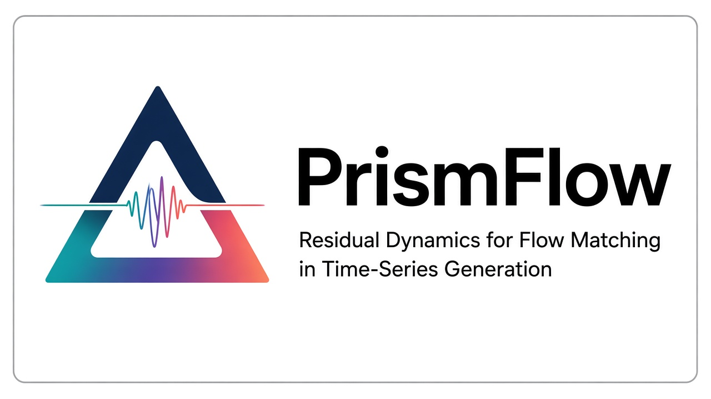
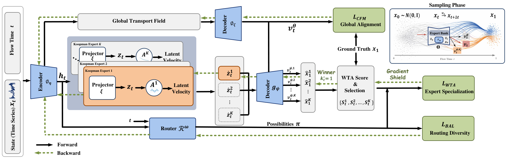

<h2 align="center">
PrismFlow: Residual Dynamics for Flow Matching in Time-Series Generation
<br><br>

<br>
<b>@ <a href="https://nips.cc/">NeurIPS 2026</a></b>
</h2>

<p align="center">
  <a href="https://arxiv.org/abs/2605.28867">
    </a>
  &nbsp;
  <a href="https://github.com/jrzhang33/PrismFlow">
    </a>
</p>

<p align="center">
  
</p>

**PrismFlow** is a flow-matching framework for time-series generation. Standard FM often relies on a single global vector-field estimator, which can average incompatible local velocities and wash out high-frequency modes. PrismFlow preserves the global transport path while introducing residual dynamical corrections through two components:

- **Koopman Experts** — a bank of latent linear experts that map nonlinear temporal evolution into a Koopman space and decode mode-specific residual velocities.
- **Confidence-aware WTA Routing** — a time-aware router selects one expert for each flow state. Only the winning expert receives the specialization update, while gradients to the remaining experts are masked.

During sampling, the selected expert adds a residual correction to the global transport field.

---

# Table of Contents

- [Installation](#installation)
- [Data Preparation](#data-preparation)
- [Training](#training)
- [Sampling](#sampling)
- [Evaluation](#evaluation)
- [Citation](#citation)
- [Acknowledgements](#acknowledgements)

---

# Installation

```bash
conda create -n prismflow python=3.10 -y
conda activate prismflow
pip install torch==2.3.1 --index-url https://download.pytorch.org/whl/cu121
pip install -r requirements.txt
export MUJOCO_GL=egl
```

---

# Data Preparation

We use the datasets from [Diffusion-TS](https://github.com/Y-debug-sys/Diffusion-TS). Download them from that repository and place the files under `datasets/`:

```
datasets/
├── stock_data.csv
├── ETTh.csv
├── energy_data.csv
└── fMRI/
    └── sim4.mat
```

Sines and MuJoCo are generated on the fly and need no download.

---

# Training

Configs live in `configs/`. Training writes checkpoints to `checkpoints/<dataset>/`.

```bash
python main.py --config configs/sines.yaml --train
python main.py --config configs/stocks.yaml --train
python main.py --config configs/etth.yaml --train
python main.py --config configs/mujoco.yaml --train
python main.py --config configs/energy.yaml --train
python main.py --config configs/fmri.yaml --train
```

---

# Sampling

Sampling loads the final checkpoint from `checkpoints/<dataset>/` and writes generated / real sequences to `OUTPUT/<dataset>/`.

```bash
python main.py --config configs/sines.yaml --sample
python main.py --config configs/stocks.yaml --sample
python main.py --config configs/etth.yaml --sample
python main.py --config configs/mujoco.yaml --sample
python main.py --config configs/energy.yaml --sample
python main.py --config configs/fmri.yaml --sample
```

---

# Evaluation

```bash
python evaluate.py --real OUTPUT/sines/real.npy --fake OUTPUT/sines/fake.npy --out_dir results/sines
python evaluate.py --real OUTPUT/stocks/real.npy --fake OUTPUT/stocks/fake.npy --out_dir results/stocks
python evaluate.py --real OUTPUT/etth/real.npy --fake OUTPUT/etth/fake.npy --out_dir results/etth
python evaluate.py --real OUTPUT/mujoco/real.npy --fake OUTPUT/mujoco/fake.npy --out_dir results/mujoco
python evaluate.py --real OUTPUT/energy/real.npy --fake OUTPUT/energy/fake.npy --out_dir results/energy
python evaluate.py --real OUTPUT/fmri/real.npy --fake OUTPUT/fmri/fake.npy --out_dir results/fmri
```

Metrics are written to `results/<dataset>/metrics.json`:
- **Context-FID**
- **Discriminative Score**
- **Predictive Score**
- **Correlational Score**

---

# Citation

```bibtex
@inproceedings{zhang2026prismflow,
  title     = {PrismFlow: Residual Dynamics for Flow Matching in Time-Series Generation},
  author    = {Zhang, Junru and Feng, Lang and Wang, Jinbo and Guo, Xu and Wang, Yucheng and Yu, Han and Wu, Min and Dong, Yabo and Xu, Duanqing},
  booktitle = {The 40th Annual Conference on Neural Information Processing Systems},
  year      = {2026}
}
```

# Acknowledgements

We thank [Diffusion-TS](https://github.com/Y-debug-sys/Diffusion-TS) for the codebase and datasets used in our experiments.

# Contact
 [junruzhang@zju.edu.cn](mailto:junruzhang@zju.edu.cn).
